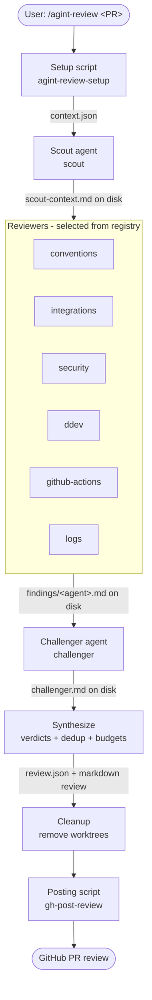

# Review (`agint-review`)

A multi-agent skill for reviewing Datadog Agent integration pull requests. Reads a PR end-to-end, runs `conventions` (the repo's `AGENTS.md` files) plus the specialists for what the PR touches, in parallel, filters their output through a challenger pass, and synthesizes everything into a single cohesive review that it posts to the PR. It runs on Claude Code and, with a sequential fallback, on harnesses without registered subagents (such as pi).

This README documents the architecture for **maintainers** of the skill — the people writing or modifying the agents, scripts, and references. The process itself (what the orchestrator does at runtime) is described only in [`SKILL.md`](./SKILL.md); this file links to it rather than restating it. When you change anything observable from outside (agent set, registry schema, script behavior, output format), check whether this file needs the change too.

---

## Table of contents

- [Invoking the skill](#invoking-the-skill)
- [Pipeline at a glance](#pipeline-at-a-glance)
- [Process overview](#process-overview)
- [Agents](#agents)
- [Scripts](#scripts)
- [References](#references)
- [Aspect filter](#aspect-filter)
- [Project-specific instructions](#project-specific-instructions)
- [Disk layout under `.agint-review/<PR>/round-<N>/`](#disk-layout-under-agint-reviewprround-n)
- [Architectural principles](#architectural-principles)
- [Security model](#security-model)
- [Maintenance notes](#maintenance-notes)

---

## Invoking the skill

```
/agint-review <PR-URL> [aspect1 aspect2 ...] [--round N]
```

The arguments are described in [SKILL.md → Parameters](./SKILL.md#parameters); aspects are listed in [Aspect filter](#aspect-filter) below. The skill is **user-invocable only** (`disable-model-invocation: true`).

---

## Pipeline at a glance



Solid arrows mark data flow that survives via files on disk; the orchestrator passes paths to agents (not file contents) so the disk file is the single source of truth at every handoff.

---

## Process overview

[`SKILL.md`](./SKILL.md) is the single source of truth for the process. In short:

| Step | What happens | Details |
|---|---|---|
| 1. Setup | `agint-review-setup` checks the environment, fetches the PR, creates the `head`/`base` worktrees, selects agents and writes `context.json`. | [SKILL.md Step 1](./SKILL.md#step-1-setup), [`scripts/README.md`](./scripts/README.md#agint-review-setup) |
| 2. Scout | One agent reads the PR end to end and writes `scout-context.md`. | [SKILL.md Step 2](./SKILL.md#step-2-scout) |
| 3. Reviewers | The selected reviewers run (in parallel when the harness has subagents), each writing `findings/<agent>.md`. | [SKILL.md Step 3](./SKILL.md#step-3-reviewers) |
| 4. Challenger | Issues keep/demote/drop/merge/contest verdicts and writes `challenger.md`. | [SKILL.md Step 4](./SKILL.md#step-4-challenger) |
| 5. Synthesize | The orchestrator applies verdicts, sorts out Follow-ups, deduplicates, and applies severity floors and the per-file budget. | [SKILL.md Step 5](./SKILL.md#step-5-synthesize) |
| 6. Save | Shows the markdown review and writes `review.json`. | [SKILL.md Step 6](./SKILL.md#step-6-save) |
| 7. Post | Worktrees are removed right after Save. Then `gh-post-review` posts the review (`REQUEST_CHANGES` if any Request, `COMMENT` otherwise, never `APPROVE`, and always `COMMENT` on your own PR; a clean review is posted too). Partial runs aren't posted, a commit is posted once, and comment labels are checked first. A failed post prints the command that retries it. | [SKILL.md Step 7](./SKILL.md#step-7-post) |

How the agents run depends on the harness: `agint-review-<name>` subagents on Claude Code, a subagent tool elsewhere if one is installed, otherwise the orchestrator follows each agent file itself, one after another. See [SKILL.md → How agents run](./SKILL.md#how-agents-run).

---

## Agents

> **Where they live**: The agents live inside the skill, at `.agents/skills/agint-review/agents/<name>.md`. Claude Code doesn't pick up agents nested inside a skill, so the repo registers each one with a symlink, `.claude/agents/agint-review-<name>.md`, and the file's `name:` is `agint-review-<name>`. When the orchestrator calls `Agent(...)`, `subagent_type` must be that prefixed name — bare `scout` will fail with "Agent type not found." The prefix also keeps the names from colliding with other agents, such as the `scout` and `reviewer` that `pi-subagents` ships. Agent files must also work as plain instructions, without their frontmatter or the subagent registration, because harnesses without registered subagents read them directly; setup writes their absolute paths into `context.json`.

| Agent | Runs on | Role |
|---|---|---|
| [`scout`](./agents/scout.md) | always (Step 2) | Reads the PR end-to-end and produces the shared scout context, including whether each touched integration is new. |
| [`conventions`](./agents/conventions.md) | every PR | Reviews only against the repository's `AGENTS.md` files as they are on the target branch, even when the PR edits one (setup passes the ones on the changed paths); cites file and section for each finding. The only agent that enforces `AGENTS.md`. |
| [`integrations`](./agents/integrations.md) | integration roots, `datadog_checks_base/**`, `datadog_checks_dev/**` | Check implementation, metrics, config spec, customer impact and compatibility. Reads [`references/integrations/`](./references/integrations/) (lifecycle, persistent cache, tests, base, dev, dashboards, monitors) by what the PR touches. |
| [`security`](./agents/security.md) | integration roots, `datadog_checks_base/**`, `datadog_checks_dev/**`, `datadog_checks_downloader/**` | Untrusted product data, credentials, TLS, commands, parsing, files and queries. |
| [`ddev`](./agents/ddev.md) | `ddev/**`, `.ddev/**` | ddev CLI: imports, output, commands, validations, CLI compatibility, repo config (`.ddev/`), tests. References live under [`references/ddev/`](./references/ddev/). |
| [`github-actions`](./agents/github-actions.md) | `.github/workflows/**`, `.github/actions/**`, `.github/chainguard/**` | Workflows, local actions and octo-sts trust policies: whether they work, security, reliability, cost, maintainability, and callers in other repos (downloaded by setup on integrations-core). |
| [`logs`](./agents/logs.md) | `**/assets/logs/**` | Log pipelines and their tests against the Logs Backend review guide, read live from Confluence with a bundled fallback; the config's and README's log source. References live under [`references/logs/`](./references/logs/). `integrations` and `security` skip these files. |
| [`challenger`](./agents/challenger.md) | always (Step 4) | Checks each finding against the tenets, the output contract and the `AGENTS.md` section it cites; keep/demote/drop/merge/contest verdicts. Its citation-failure and cluster-consistency protocols are documented in the agent file. |

Each agent's model is set by the orchestrator from [SKILL.md › Models per subagent](./SKILL.md#models-per-subagent); the agent files carry no `model:`.

| PR touches | Agents |
|---|---|
| An integration, `datadog_checks_base` or `datadog_checks_dev` | `conventions`, `integrations`, `security` |
| `datadog_checks_downloader` | `conventions`, `security` |
| `ddev/`, `.ddev/` | `conventions`, `ddev` |
| `.github/workflows/`, `.github/actions/` or `.github/chainguard/` | `conventions`, `github-actions` |
| `<integration>/assets/logs/` | `conventions`, `logs` |
| Anything else (`.builders/`, `docs/`, root files) | `conventions` |

Every reviewer and the challenger get [`tenets.md`](./references/tenets.md), [`common-agent-instructions.md`](./references/common-agent-instructions.md) and [`comment-style.md`](./references/comment-style.md). Only `conventions` reviews what an `AGENTS.md` says; the other agents don't get those files and don't restate their rules. A repo convention that matters but isn't in an `AGENTS.md` isn't enforced by any agent: add it to `AGENTS.md`.

The registry ([`references/agent-registry.toml`](./references/agent-registry.toml)) is the source of truth for which agent matches which files — never duplicate matching logic anywhere else. An agent can also list `exclude_globs`, which take files away from it whatever else matches: `integrations` and `security` exclude `**/assets/logs/**` so only `logs` reviews pipelines.

---

## Scripts

All three scripts are pure Python 3.11+ (stdlib only) and live under [`scripts/`](./scripts/). Their CLI and behavior are documented in [`scripts/README.md`](./scripts/README.md) and in each script's docstring.

| Script | When it runs |
|---|---|
| [`agint-review-setup`](./scripts/agint-review-setup) | Start of every review (Step 1). Pure plumbing; produces `context.json`. |
| [`gh-post-review`](./scripts/gh-post-review) | End of every review (Step 7). Checks the PR head SHA, picks the event from the comment labels, snaps comments to diff lines, and falls back to the review body rather than losing a comment. |
| [`agint-review-cleanup`](./scripts/agint-review-cleanup) | Right after synthesis, before posting, and from setup for leftover worktrees. Removes worktrees only. |

---

## References

| File | What it's for |
|---|---|
| [`agent-registry.toml`](./references/agent-registry.toml) | Source of truth for which agents fire on which files. |
| [`tenets.md`](./references/tenets.md) | The eight tenets: how every agent reviews, whatever its area, plus Severity by repository (on integrations-extras, marketplace and integrations-internal, a Request only for a security issue or something actually broken). In every reviewer's and the challenger's instructions; the challenger enforces it. |
| [`common-agent-instructions.md`](./references/common-agent-instructions.md) | The reviewers' output contract: finding fields, the `N/A` rule, evidence, scout-flagged concerns, a clean review. In every reviewer's and the challenger's instructions. |
| [`comment-style.md`](./references/comment-style.md) | Wording rules and the comment types (Request, Suggestion, Question, Nit, Follow-up). In every reviewer's and the challenger's instructions. |
| [`output-format.md`](./references/output-format.md) | Final review markdown layout, JSON `comments` schema, anchoring guidance for off-diff findings. Used by the orchestrator at synthesis time. |
| [`prompt-templates.md`](./references/prompt-templates.md) | The scout, reviewer and challenger prompt templates. Also documents the pass-by-reference principle. |
| [`integrations/lifecycle.md`](./references/integrations/lifecycle.md), [`integrations/persistent-cache.md`](./references/integrations/persistent-cache.md), [`integrations/tests.md`](./references/integrations/tests.md), [`integrations/datadog-checks-base.md`](./references/integrations/datadog-checks-base.md), [`integrations/datadog-checks-dev.md`](./references/integrations/datadog-checks-dev.md) | Rules the integrations reviewer reads by what the PR touches. |
| [`integrations/metric-types.md`](./references/integrations/metric-types.md) | The `metadata.csv` metric-type rule. Setup gives it to the integrations reviewer only on repos without `AGENTS.md`; on integrations-core it's in the root `AGENTS.md`, for `conventions`. |
| [`logs/hard-checks.md`](./references/logs/hard-checks.md), [`logs/collection.md`](./references/logs/collection.md) | The logs reviewer's local overrides and fallback for when the guide can't be read, and the config and README log source cross-check. |
| [`ddev/imports.md`](./references/ddev/imports.md), [`ddev/output.md`](./references/ddev/output.md), [`ddev/commands.md`](./references/ddev/commands.md), [`ddev/testing.md`](./references/ddev/testing.md) | Rules the ddev reviewer reads by what the PR touches. |

---

## Aspect filter

Pass aspect keywords to restrict which reviewers run:

| Keyword | Behavior |
|---|---|
| `conventions`, `integrations`, `security`, `ddev`, `github-actions`, `logs` | Run only the named reviewers (when they match the PR's files). |
| `post` | Post the latest round's saved `review.json` without reviewing again, e.g. after a failed post. |
| `all` (default) | Run everything that matches. |

Only a full review is posted: a run narrowed by an aspect filter is saved but not posted (`context.json.post` is `false`), so the Slack coordinator never reads a partial review as a complete one. A commit is posted once; `gh-post-review --repost` posts it again.

---

## Project-specific instructions

Repos can drop rule files into `.claude/agint-review/`:

- `common.md` — applies to every reviewer.
- `conventions.md`, `integrations.md`, `security.md`, `ddev.md`, `github-actions.md`, `logs.md` — per-agent.

These take priority over the general guidelines in [`references/`](./references/) when they conflict, and let teams encode local conventions without forking the skill.

The setup script ([`scripts/agint-review-setup`](./scripts/agint-review-setup)) resolves these into `context.json` at run time — combining the bundled shared rules with any project-specific files, in the right order, per agent. The orchestrator never Globs `.claude/agint-review/`; it pastes `agents_to_run[i].instruction_paths` verbatim into each reviewer's prompt and `challenger_instruction_paths` into the challenger's. Same disk-as-source-of-truth contract as the per-agent diffs.

---

## Disk layout under `.agint-review/<PR>/round-<N>/`

Every review run lives under a `round-<N>/` subdirectory — round 1 is the natural home for a brand-new review, and round 2, 3, … preserve per-round history when the PR is re-reviewed (see [SKILL.md Step 1](SKILL.md#step-1-setup)). Setup cleans up older rounds of the same PR, so they keep only the slim trail below. The contents below describe a single round dir; the parent `.agint-review/<PR>/` just contains those round dirs side by side.

```
.agint-review/<PR>/round-<N>/
├── context.json                  # written by setup; read by every later step. Kept.
├── scout-context.md              # written by scout; read by reviewers + challenger. Kept.
├── diff.full                     # full PR diff. Kept.
├── diffs/<agent>.diff            # per-agent filtered diffs. Kept.
├── findings/<agent>.md           # one file per reviewer's raw output. Kept.
├── callers/                      # workflows of other repos calling integrations-core @master, plus index.md; only for github-actions on integrations-core. Kept.
├── challenger.md                 # full challenger report. Kept.
├── review.json                   # final synthesized review. Kept.
├── head/                         # read-only worktree with the PR applied. Removed right after synthesis.
└── base/                         # read-only worktree without the PR. Removed right after synthesis.
```

Only the worktrees are removed when a round ends; the text files stay (a round is a few hundred KB), so the user can still ask for the suppressed comments and a failed post can be retried. The whole `<PR>/` folder is deleted by setup, at the start of a later run, once `gh` reports the PR as merged or closed.

---

## Architectural principles

These are load-bearing — when changing the skill, preserve them.

- **Pass paths, not content.** The orchestrator never string-substitutes file bytes into prompts. It passes absolute paths and sub-agents do their own `Read`. This keeps the orchestrator's context small, eliminates a hallucination/distortion vector, and makes the disk file the single source of truth at every handoff.
- **Paths come from `context.json`.** `SKILL.md` has no harness-specific substitution: the orchestrator resolves only the setup script (in `scripts/` next to `SKILL.md`), and setup writes every other absolute path (scripts, references, agent files, round files) into `context.json`. **Never `Glob` for skill files** — other checkouts and older installs can hold stale copies, and Glob lookups are non-deterministic across them.
- **No interactive steps.** Nothing in the required path asks the user a question or depends on Claude-only tools (`AskUserQuestion`, task lists, messaging or resuming subagents), so the skill runs the same on other harnesses.
- **Disk persistence at every agent boundary.** Scout writes `scout-context.md`; reviewers' outputs land in `findings/`; challenger writes `challenger.md`. Synthesis re-reads from disk rather than relying on the orchestrator's compressed conversation memory.
- **Registry as source of truth.** Agent selection is driven entirely by [`references/agent-registry.toml`](./references/agent-registry.toml). The setup script reads it, the SKILL.md references it, and there is no parallel agent list anywhere. When adding or changing an agent, edit the registry.
- **Read-only worktrees.** The `head` and `base` worktrees exist so agents can read full file context, not just the diff. They are never modified.

---

## Security model

This skill reads attacker-influenceable input (PR descriptions, diff text, commit messages) into agent contexts. Prompt injection is therefore a real consideration — an adversarial PR could try to get a sub-agent to run something it shouldn't. What follows is the actual permission flow and the threat surface, so maintainers can reason about it accurately.

### Permission inheritance, not bypass

The agent files do **not** carry `permissionMode`, `hooks` or `mcpServers`. The sub-agents **inherit the parent session's permission mode** (auto, default, etc.). The skill defines no human checkpoint of its own: the review is posted automatically at the end. `SKILL.md`'s `allowed-tools` pre-approves no Bash commands. A pattern such as `Bash(python3 *scripts/gh-post-review *)` would also match a script of the same name that a PR adds inside the head worktree, and the frontmatter can't name the install-specific absolute path. So the setup, posting and cleanup scripts go through the session's permission mode like any other command, and `SKILL.md` tells the orchestrator to run only the exact `paths.*` values from `context.json`.

### Tool surface per agent

Each sub-agent's `tools:` field is a name-level allowlist (no pattern syntax — only the parent skill's `allowed-tools` supports `Bash(pattern)`, and that scope applies to the orchestrator only, not to spawned sub-agents). The current allocation is deliberately minimal:

| Agent | Bash | Why |
|---|---|---|
| `scout` | yes | Explicitly needs `git` commands inside the worktrees for history archeology |
| `challenger` | yes | Verifies findings (lint configs, quick checks) |
| `conventions`, `integrations`, `security`, `ddev`, `github-actions` | **no** | Read/Grep/Glob (plus Write for their findings file) cover their work; Bash is unnecessary attack surface |
| `logs` | **no** | Read/Grep/Glob/WebSearch/WebFetch/Write, plus the Atlassian Confluence read tools: WebFetch reads the vendor's log documentation, Confluence the review guide; no Bash, and it never posts Confluence comments |

If a reviewer ever needs Bash for a real use case, add it to that agent's `tools` field with a comment explaining what it's for. Default-deny is cheaper than discovering an injection vector later.

### Why `Bash(pattern)` scoping is not available at the agent level

We can't write `tools: Bash(git *)` in an agent file. The skill frontmatter's `allowed-tools` does support patterns (this skill doesn't use them for Bash; see above), but that scope governs the orchestrator's tool calls, not spawned sub-agents. Sub-agents inherit from the parent **session**, not the invoking skill.

If a deployment wants tighter sub-agent Bash scoping, the user can add `permissions.allow` / `permissions.deny` rules to their `settings.json`. That's session-wide — not something the skill can ship — but it's the only mechanism available today.

### Prompt-injection threat model

What an injected sub-agent could do, given the current tool surface:

- Read worktree files (read-only by convention; the worktrees are detached and disposable, so even an unintended write would not corrupt the user's actual working tree).
- Write to its own findings file. Synthesis re-reads it from disk and the challenger filters it first, but the result is posted without a human looking at it, so an injected finding can reach the PR as a comment.
- For agents with Bash (`scout`, `challenger`): run shell commands within whatever the parent session's permission mode auto-approves. In `auto` mode, that's a fairly broad surface; in `default`, the user gets prompted.

What it cannot do: spawn other sub-agents (sub-agents can't recurse), post to GitHub from a reviewer (only the orchestrator runs `gh-post-review`; reviewers have no Bash, and the scout's and challenger's Bash goes through the session's permission mode), modify agent files or registry (those live outside the worktree).

### When changing the threat surface

If you're adding a new tool, a new agent, or expanding what an agent reads:

- Adding `Bash` to an agent's `tools` — justify in a comment why Read/Grep/Glob aren't sufficient.
- Adding `WebFetch` or `WebSearch` — these are read-only and information-only, but the responses become part of the agent's context (so a maliciously-served URL fetched from the diff could prompt-inject the agent further down the chain).
- Adding agents that read user-supplied paths (e.g., `--add-dir`, custom config files) — sandbox the read scope to the review directory.

The principle: **default-deny on tools, default-deny on web access, document the threat surface when expanding it.**

---

## Maintenance notes

- **Adding a new reviewer**: drop a new `agents/<name>.md` file (with `name: agint-review-<name>`), add its `.claude/agents/agint-review-<name>.md` symlink and `.gitignore` entry at the repo root, add an entry to `references/agent-registry.toml` (with its `aspect`, and `globs` and/or `matches`, and `exclude_globs` to take paths from another agent), add it to `AGENT_RULE_FILES` in `scripts/agint-review-setup`, and update the agent tables in this README and in `SKILL.md`. The setup script picks it up automatically.
- **Adding a new aspect keyword**: just give the agent the new aspect string in the registry. Update the [Aspect filter](#aspect-filter) table here and in `SKILL.md`.
- **Changing the registry schema**: also update `scripts/agint-review-setup` and the schema docs in `scripts/README.md`. The script's selection logic is the only consumer.
- **Changing how agents review, what they write, or how comments are worded**: update `references/tenets.md`, `references/common-agent-instructions.md` or `references/comment-style.md`. All three are in every reviewer's instructions automatically — no agent-file edits needed for global rule changes. `references/output-format.md` is the orchestrator's final format.
- **Changing what gets cleaned up**: update `scripts/agint-review-cleanup`, `sweep_review_base` in `scripts/agint-review-setup`, SKILL.md Steps 1 and 6, `scripts/README.md`, and the [disk layout](#disk-layout-under-agint-reviewprround-n) above. Anything not listed there will accumulate forever.
- **Verifying a script change end-to-end**: run the script directly against a real merged PR (not the full skill) before testing the full pipeline. The setup script's stderr summary tells you which agents would run for that PR — useful for catching registry mistakes without paying for a full review.
